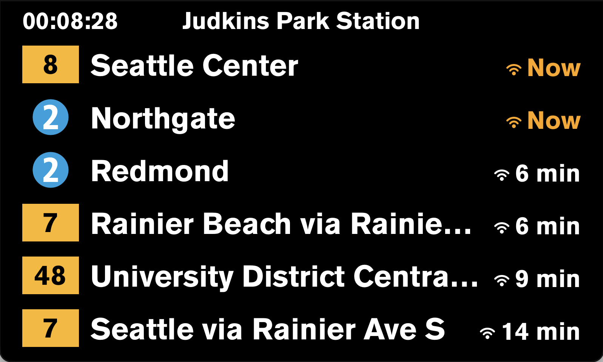

# board

A real-time transit departure board built with [Slint](https://slint.dev/), displaying arrivals from the [OneBusAway](https://onebusaway.org/) Puget Sound API.

This is a fork of the original project by [haylinmoore](https://github.com/haylinmoore/board).

Designed to run on a PROXmobil3 with a framebuffer display, but also works as a desktop window for development.



## Configuration

Requires the `OBA_API_KEY` environment variable to be set with an [OneBusAway Puget Sound API key](https://www.soundtransit.org/help-contacts/business-information/open-transit-data-otd). Email `oba_api_key@soundtransit.org` to request one. Until then, you can use the key `TEST` which doesn't use real data but will still show something!

## Usage
Takes no command line arguments.

```
board
```

Example:
```
OBA_API_KEY=your-key cargo run
```

## How to use / QR Codes
After startup, it will begin to read from the barcode scanner (/dev/ttyUSB0) on the proxmobil3 or the command line (stdin) on desktop. QR codes or command line inputs should be formatted like:

```
Station Name:station_code_1 station_code_2 ...\n
```
The newline is very important because the code uses the `getline` function.
The barcode scanner can be configured to automatically send a newline after every scan, or you can put one manually in the qr code.

Scanning a new qr code will let you change the station at any time!

## Example QR codes
</img>
</img>
</img>
## Building

### Desktop (x86, windowed)

```
echo "U District:40_990001 40_990002" OBA_API_KEY=your-key cargo run
```

### ARM (PROXmobil3, framebuffer)

```
cargo zigbuild --release --target armv7-unknown-linux-gnueabihf.2.28 --no-default-features --features framebuffer
```

## Deploying to PROXmobil3

1. Build the ARM binary (see above).

2. Copy the binary to the device over SSH:
   ```
   cat target/armv7-unknown-linux-gnueabihf/release/board | ssh root@<DEVICE_IP> 'cat > /init/board/exe && chmod +x /init/board/exe'
   ```

3. Create the systemd service at `/init/board/board.service` on the device:
   ```ini
   [Unit]
   Description=Board Display Service
   After=network.target

   [Service]
   Type=simple
   Environment=OBA_API_KEY=your-key
   ExecStart=/init/board/exe
   Restart=always
   RestartSec=2
   WorkingDirectory=/init/board

   [Install]
   WantedBy=multi-user.target
   ```

4. Create the autorun script at `/init/autorun/99-board.sh` to install the service on boot:
   ```sh
   #!/bin/sh

   mount -o remount,rw /

   # Set timezone (adjust as needed)
   ln -sf /usr/share/zoneinfo/America/Los_Angeles /etc/localtime

   # Disable default PM3 UI
   systemctl stop nx
   systemctl mask nx
   systemctl stop init-abtproxy
   systemctl mask init-abtproxy

   # Install and start board service
   cp /init/board/board.service /etc/systemd/system/
   systemctl daemon-reload
   systemctl enable board.service

   mount -o remount,ro /

   /usr/bin/NxExe watchdog 0

   systemctl start board.service
   ```

5. To update the stop or API key later:
   ```
   ssh root@<DEVICE_IP>
   mount -o remount,rw /
   vi /init/board/board.service
   mount -o remount,ro /
   systemctl daemon-reload
   systemctl restart board.service
   ```

## Debug CLI

Inspect raw API data and see how arrivals are deduplicated:

```
OBA_API_KEY=your-key cargo run --bin debug_arrivals -- "University District" 40_990001 40_990002
```

## Development

Uses Nix for the development environment:

```
nix-shell
```

## License

[MIT](LICENSE)
