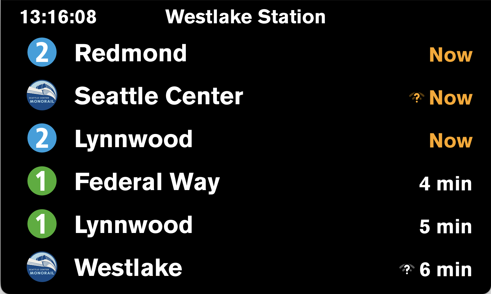
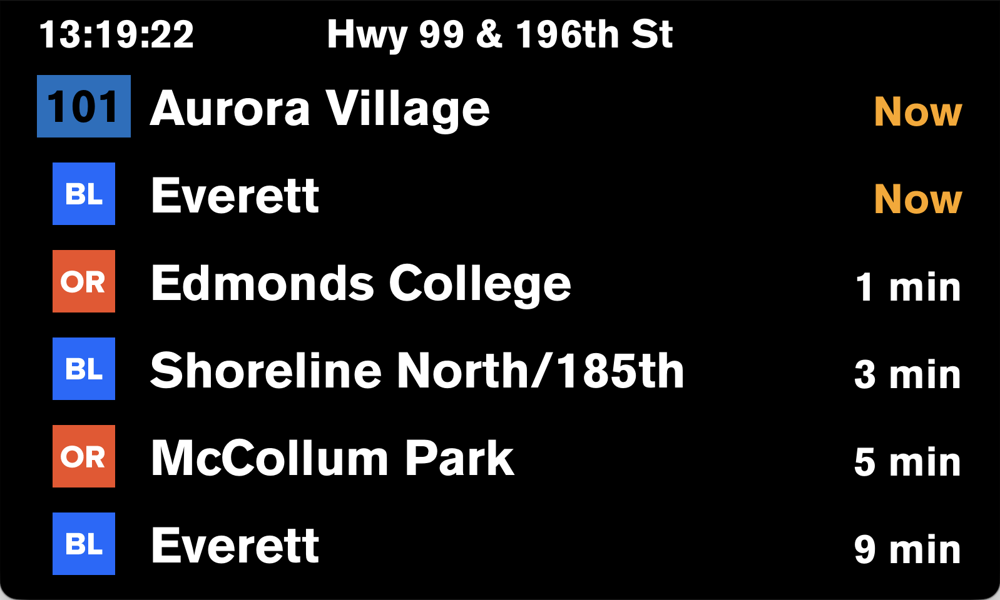
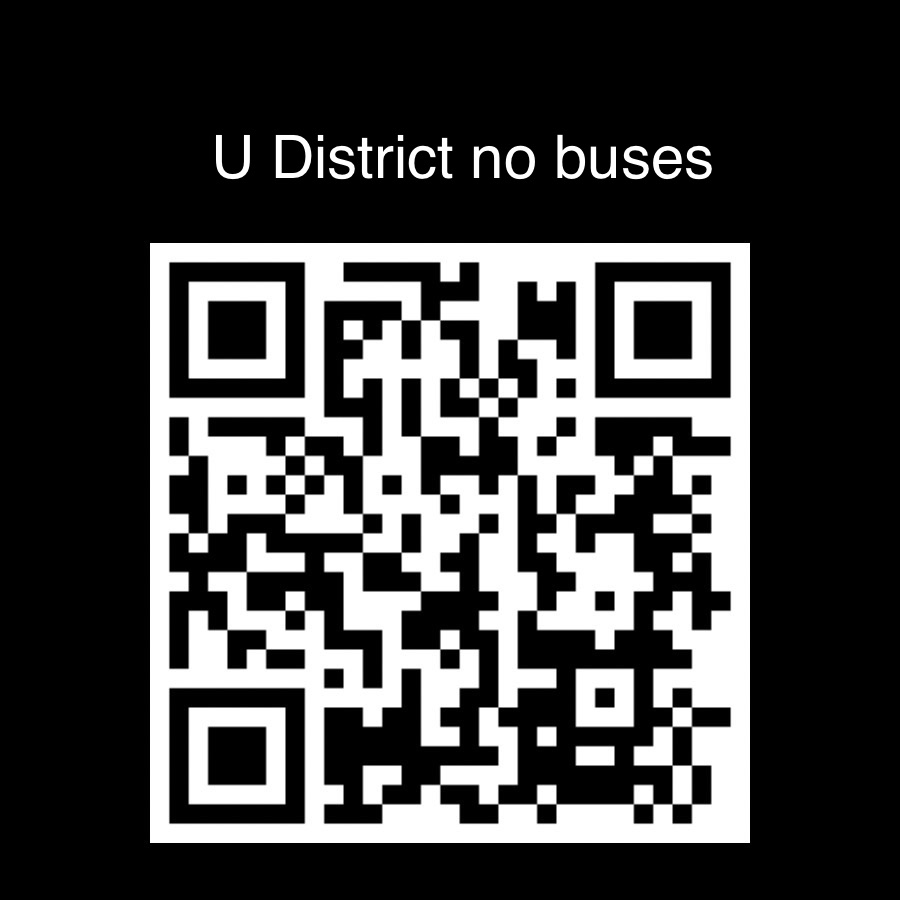
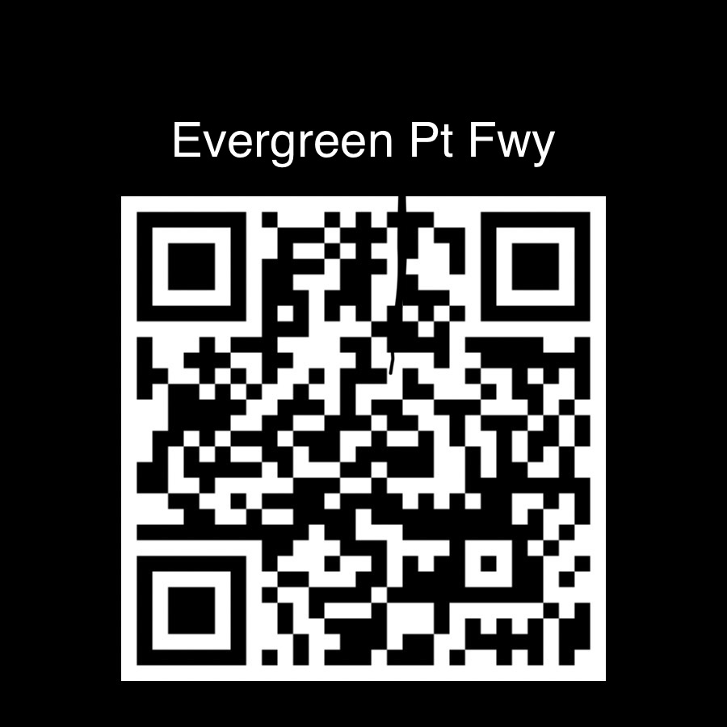

# board

A real-time transit departure board built with [Slint](https://slint.dev/), displaying arrivals from the [OneBusAway](https://onebusaway.org/) Puget Sound API. Uses the NFC reader and QR scanner to change which station/stop it displays!

</img>

On the PROXmobil3, you can tap NFC cards to the builtin reader or scan QR codes with the builtin scanner to change which stop is displayed.

Designed to run on a PROXmobil3 with a framebuffer display, but also works as a desktop window for development. 

Displays route icons for Link, Sounder, the Seattle Center Monorail, Metro RapidRide, and Swift BRT.

For communications with the builtin cvend plug on the proxmobil3, it uses my [feigctrl](https://github.com/benorei/feigctrl) library (not yet on crates.io).

This is a fork of the original project by [haylinmoore](https://github.com/haylinmoore/board). I added enhanced graphics, NFC, and QR support.




## Configuration

Requires the `OBA_API_KEY` environment variable to be set with an [OneBusAway Puget Sound API key](https://www.soundtransit.org/help-contacts/business-information/open-transit-data-otd). Email `oba_api_key@soundtransit.org` to request one. Until then, you can use the key `TEST` which doesn't use real data but will still show something!

## Download

You can download precompiled binaries for Mac OS and the Proxmobil3 from the "releases" section on the right. The one just labeled `board` is for the PM3.

## Usage
Takes no command line arguments, but the `OBA_API_KEY` environment variable must be set.

```
board
```

Example:
```
OBA_API_KEY=your-key cargo run
```

## How to use / NFC & QR Codes
After startup, it will begin to communicate with the NFC reader (/dev/ttyUSB3) and read from the barcode scanner (/dev/ttyUSB0) on the proxmobil3 or the command line (stdin) on desktop. NFC card text records, QR codes or command line inputs should be formatted like:

```
Station Name:agency_station1 agency_station2 ...\n
```
The formatting is the same regardless of how it's being entered. 

**NFC Tags**
For an NFC tag, use an app like NFC21 Tools to write the string as text to a programmable NTAG213/215/216 tags (these are the most common tags you can get online). I've only tested it with NTAG215 tags, but it should work with all three.

**QR Codes**
The best way to make a QR code is the command line utility `qrencode` (`brew install qrencode` on mac). Don't use online QR code generators, as these often put their own links in the QR code that redirect to your content, which will not work on the pm3.

The newline at the end is required because the code uses the `getline` function.
The barcode scanner can be configured to automatically send a newline after every scan instead (this makes it easier to do other stuff with the reader too!)

**Building your own station string**
The station/stop codes must be prefixed with the agency number (40 for Sound Transit and 1 for King County Metro). If you're using an app like OneBusAway to get the stop number, prefix the agency number to what you see in the app. For example, the Broadway E & E Mercer St northbound stop is listed as `#11200` in the app, but you should enter `1_11200` in this program because the agency number for KCM is 1. Seattle-area agency numbers are available in [`/agencies.txt`](/agencies.txt).

Tapping an NFC tag or scanning a new qr code will let you change the station at any time!

## Example QR codes
</img>
</img>
</img>

More codes are available in [`/qrs`](/qrs).

## Example stop strings for NFC/QR
```
Judkins Park Station:40_E01-T1 40_E01-T2 1_35922 1_35911 1_35924 1_35923

King Street Station:40_S_KS 40_S_KS_T3

Chinatown/King Street:40_S_KS 40_S_KS_T3 40_621 40_623

Hwy 99 & 196th St:29_2764 29_3247 29_3246 29_3225 29_1503 29_1007

Westlake Station:40_1108 40_1121 96_WL 1_26680

Seattle Ferry Terminal:95_7 1_1889 20_1323

Bainbridge Island Terminal:95_3 20_861

Capitol Hill Station:1_11175 40_99610 40_99603
```
## Building

### Desktop (untested outside of MacOS)

```
echo "U District:40_990001 40_990002" | OBA_API_KEY=your-key cargo run
```

### ARM (PROXmobil3)

```
cargo zigbuild --release --target armv7-unknown-linux-gnueabihf.2.28 --no-default-features --features proxmobil3
```

## Deploying to PROXmobil3
1. Build the ARM binary (see above).

2. Copy the binary to the device's USB drive over SSH:
   ```
   scp -O target/armv7-unknown-linux-gnueabihf/release/board root@<DEVICE_IP>:/init/board/efad/mp_sd
   ```

   You can also just put it in the root directory of the connected USB drive for the same effect.

3. Make the file runnable (Only needs to be done the first time you copy it over)
   ```
   chmod +x /init/efad/mp_sd/board
   ```

4. Disable default UI (only persists until next reboot)
   ```
   sudo systemctl stop nx
   sudo systemctl stop init-abtproxy
   ```

5. Run!
   ```
   /init/efad/mp_sd/board
   ```

Because it was run over SSH, it will only run as long as the SSH session is active. To run it automatically when the pm3 starts up, put this in the `autorun.sh` script in the root directory of your USB drive:

```
systemctl stop nx  # stop default graphics
systemctl stop init-abtproxy  # stop default graphics
OBA_API_KEY=your_key /init/efad/mp_sd/board
```


## Debug CLI

Inspect raw API data and see how arrivals are deduplicated:

```
OBA_API_KEY=your-key cargo run --bin debug_arrivals -- "University District" 40_990001 40_990002
```
## License & Attribution

[MIT](LICENSE)

Scheduled trip icon from: https://www.svgrepo.com/svg/532122/clock-three

Ferry icon from: https://www.svgrepo.com/svg/15727/ferry

Washington State DOT logo from: https://commons.wikimedia.org/wiki/File:WSDOT_Logo.svg

Sound Transit route icons from: https://commons.wikimedia.org/wiki/File:Line_1_(Sound_Transit)_icon.svg

Swfit BRT route icons from: https://commons.wikimedia.org/wiki/Category:Swift_Bus_Rapid_Transit

RapidRide route icons from: https://commons.wikimedia.org/wiki/Category:RapidRide_icons

Seattle Streetcar icon from: https://commons.wikimedia.org/wiki/File:Seattle_Streetcar_symbol.svg
